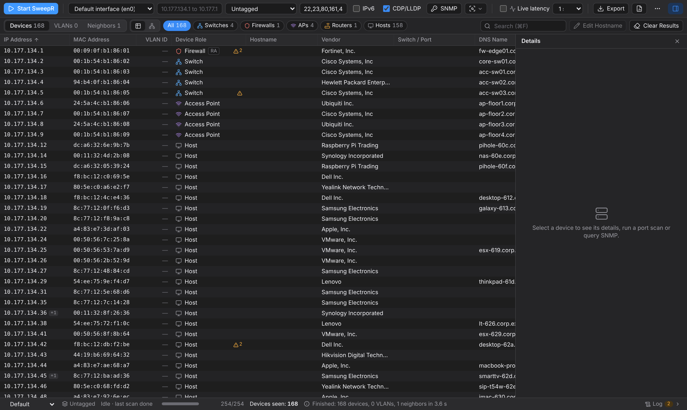
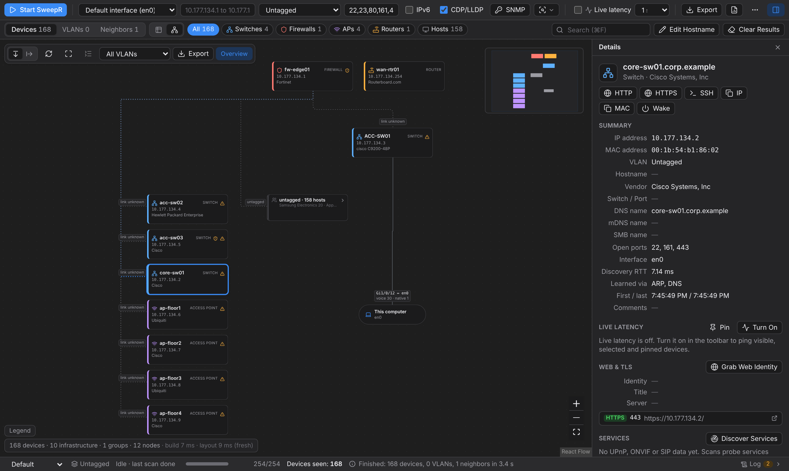
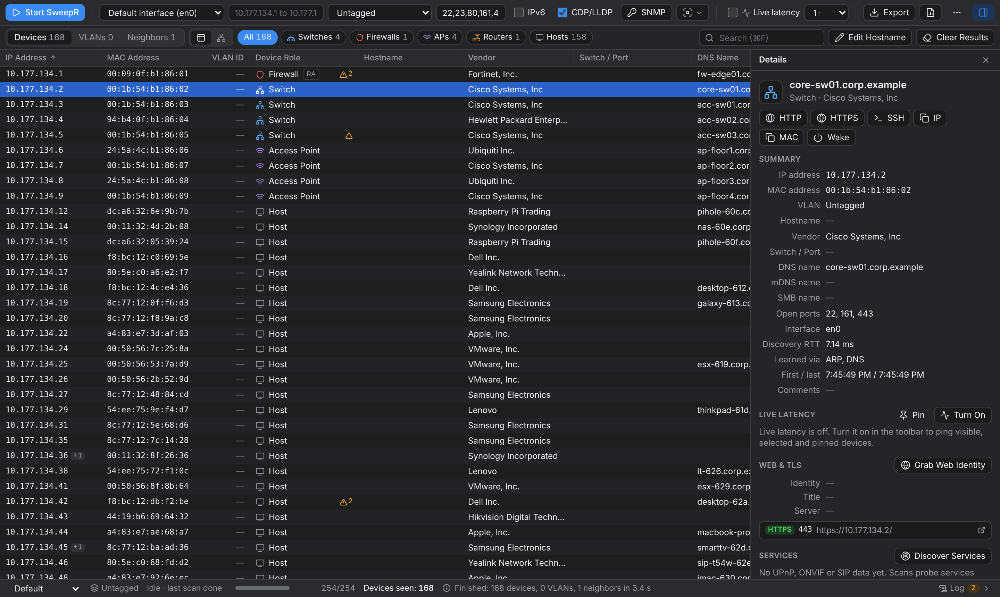

<div align="center">

# SweepR

**See everything on your network: every host, every VLAN, every switch port.**

A fast IPv4/IPv6 network scanner for macOS, Linux and Windows, built for enterprise networks.
Live discovery, 802.1Q VLAN scanning, CDP/LLDP and SNMP infrastructure mapping, service
discovery and a one-click security audit report, in a native desktop app and a scriptable CLI.

[Install](#install) · [Platform support](#platform-support) · [Features](#features) · [CLI usage](#cli-usage) · [Audit report](#audit-report) · [Build from source](#build-from-source-and-install-to-path)



</div>

## Why SweepR

- **Live results.** Hosts show up the moment they answer, with vendor, host name, open ports
  and role (switch, router, firewall, access point, host).
- **VLAN-aware.** Probe tagged VLANs from a trunk port, or listen passively to learn which
  VLANs, native VLANs and voice VLANs are in use.
- **Knows your infrastructure.** CDP, LLDP and SNMP (v1/v2c/v3) reveal switches, their models
  and firmware, PoE budgets and the exact switch port every endpoint is plugged into.
- **Finds what is behind the IP.** UPnP, ONVIF cameras with their stream URLs, SIP phones and
  PBXs, web appliances and their TLS certificates, DHCP client fingerprints.
- **Turns a scan into an audit.** A risk-graded HTML, PDF or JSON report with findings,
  evidence and remediation (Telnet, default SNMP communities, rogue IPv6 routers, native
  VLAN 1, expiring certificates, PoE over budget and more).
- **Network toolbox built in.** Wake-on-LAN, live latency monitor, MTR-style traceroute,
  web identity grabber and iPerf3 throughput tests, right from a device's details.
- **Safe on hostile networks.** Bounded walks and parsers, no credentials ever sent to
  discovered devices, hardened file writes and escaped output everywhere.

<table>
  <tr>
    <td width="50%"></td>
    <td width="50%"></td>
  </tr>
  <tr>
    <td align="center"><sub><b>Topology map</b>: infrastructure, links and host groups per VLAN</sub></td>
    <td align="center"><sub><b>Device details</b>: one-click HTTP/SSH, Wake-on-LAN, latency, TLS, services</sub></td>
  </tr>
</table>

<sub>Screenshots show the built-in demo network (`npm run dev`).</sub>

## Install

SweepR is one self-contained binary, `sweepr` (`sweepr.exe` on Windows): the desktop app and
the command-line tool in one file. Download it for your platform, check its SHA-256, and put
it on your `PATH`.

- **Releases**: tagged versions are on the [Releases](../../releases) page.
- **Latest build**: every pull request and push to `main` also builds all platforms. Open the
  newest run of [Build binaries](../../actions/workflows/build-binaries.yml) (signed in to
  GitHub) and download the archive from *Artifacts*; GitHub wraps each one in an extra zip.

| Archive | For |
| --- | --- |
| `sweepr-<version>-macos-arm64.tar.gz` | macOS 11+ on Apple Silicon |
| `sweepr-<version>-macos-universal.tar.gz` | macOS 11+ on Apple Silicon and Intel (one universal binary) |
| `sweepr-<version>-linux-x86_64.tar.gz` | 64-bit Linux with glibc 2.35+ (Ubuntu 22.04+, Debian 12+, Fedora 36+) |
| `sweepr-<version>-linux-aarch64.tar.gz` | arm64 Linux with glibc 2.35+ |
| `sweepr-<version>-windows-x86_64.zip` | Windows 10 / 11, x64 |

Each archive holds the binary and an `INSTALL.txt` with the steps below. `SHA256SUMS` lists
the checksum of every archive (each archive also has its own `.sha256` file):

```sh
sha256sum -c SHA256SUMS --ignore-missing        # Linux
shasum -a 256 -c SHA256SUMS --ignore-missing    # macOS
```

```powershell
# Windows: compare with the line for the zip in SHA256SUMS
(Get-FileHash .\sweepr-0.1.0-windows-x86_64.zip -Algorithm SHA256).Hash.ToLower()
```

### macOS

```sh
tar -xzf sweepr-0.1.0-macos-arm64.tar.gz        # Intel Mac: sweepr-0.1.0-macos-universal.tar.gz
cd sweepr-0.1.0-macos-arm64
xattr -d com.apple.quarantine sweepr 2>/dev/null
sudo install -m 755 sweepr /usr/local/bin/sweepr
sweepr --version
```

- `macos-arm64` is a native Apple Silicon build. `macos-universal` holds Apple Silicon and
  Intel code in one file (`lipo -info sweepr` shows both); use it on Intel Macs or when one
  binary must serve both.
- The binaries are ad-hoc signed, not notarized. A file downloaded with a browser carries the
  quarantine flag, and macOS refuses to run it ("cannot be verified", "is damaged");
  `xattr -d com.apple.quarantine sweepr` clears the flag (no output when there was none).
- Without `sudo`: `mkdir -p ~/.local/bin && install -m 755 sweepr ~/.local/bin/sweepr`, and
  add `export PATH="$HOME/.local/bin:$PATH"` to `~/.zshrc`.
- `sweepr` starts the desktop app; `sudo sweepr --gui` starts it with raw packet access, and
  `sudo sweepr scan` scans from the terminal. See [Privileges](#privileges).

### Linux

```sh
sudo apt install libwebkit2gtk-4.1-0 libgtk-3-0 libpcap0.8   # runtime libraries (Debian / Ubuntu)
# Fedora: sudo dnf install webkit2gtk4.1 gtk3 libpcap
tar -xzf sweepr-0.1.0-linux-x86_64.tar.gz
sudo install -m 755 sweepr-0.1.0-linux-x86_64/sweepr /usr/local/bin/sweepr
sudo setcap cap_net_raw,cap_net_admin=eip /usr/local/bin/sweepr   # raw scans without sudo
sweepr --version
```

- The capabilities let `sweepr` (CLI and GUI) send raw ARP / 802.1Q / NDP frames and capture
  without `sudo`. Replacing the file drops them: run `setcap` again after every update. The
  alternative is `sudo sweepr scan ...` (a GUI started with `sudo` also needs access to your
  display, so `setcap` is the better choice for the desktop app).
- Without root for the copy: `install -m 755 .../sweepr ~/.local/bin/sweepr` (most
  distributions put `~/.local/bin` on `PATH`). `setcap` still needs `sudo`, and the file
  system must not be mounted `nosuid`.

### Windows

1. Install **Npcap** from [npcap.com](https://npcap.com) (the default options are fine;
   "WinPcap API-compatible mode" is optional, SweepR loads Npcap from `System32\Npcap`
   either way). It provides raw ARP, 802.1Q, IPv6 NDP and CDP / LLDP / DHCP capture.
   Without it SweepR still runs and falls back to an ICMP sweep.
2. Unzip the archive and put `sweepr.exe` on your user `PATH` (PowerShell, no administrator
   rights needed):

   ```powershell
   Expand-Archive .\sweepr-0.1.0-windows-x86_64.zip -DestinationPath .
   $dir = "$env:LOCALAPPDATA\Programs\SweepR"
   New-Item -ItemType Directory -Force $dir | Out-Null
   Copy-Item .\sweepr-0.1.0-windows-x86_64\sweepr.exe $dir
   $path = [Environment]::GetEnvironmentVariable("Path", "User")
   if (($path -split ";") -notcontains $dir) {
     [Environment]::SetEnvironmentVariable("Path", "$path;$dir", "User")
   }
   ```

   Open a new terminal and run `sweepr --version`. The same can be done in *Settings →
   System → About → Advanced system settings → Environment Variables → Path*, or with
   `setx PATH "%PATH%;%LOCALAPPDATA%\Programs\SweepR"` in `cmd` (careful: `setx` writes the
   combined machine + user `PATH` into the user variable and truncates it at 1024 characters).
3. The desktop app uses the Microsoft Edge **WebView2** runtime, which is part of Windows 11
   and current Windows 10. If the window does not open, install the Evergreen runtime from
   [Microsoft](https://developer.microsoft.com/microsoft-edge/webview2/).
4. Run `sweepr` (desktop app) or `sweepr scan` in a terminal. Interfaces carry their Windows
   connection names: `sweepr interfaces`, `sweepr scan -i "Ethernet"`. If Npcap was installed
   with *Restrict Npcap driver's access to Administrators only*, start SweepR from an
   elevated terminal (*Run as administrator*).

The executable is not code-signed: SmartScreen may show "Windows protected your PC" for a
downloaded copy (*More info → Run anyway*, or `Unblock-File .\sweepr.exe`). Windows Defender
Firewall may ask once whether `sweepr.exe` may receive discovery replies (SSDP, WS-Discovery,
mDNS); allow it on private networks.

## How it runs

The `sweepr` binary has two front-ends that share one Rust engine (`sweepr_core`):

- **GUI**: run it with no arguments or with `--gui`. This starts the Tauri desktop app. (On
  Windows a start from Explorer or a shortcut closes the console window that comes with it; a
  start from a terminal keeps the terminal attached for log output, `start sweepr` detaches.)
- **CLI**: run it with a subcommand (`sweepr scan ...`). It scans in the terminal and exits.

## Platform support

Everything except raw layer-2 access works unprivileged on all three systems. The Windows
build is compiled, unit-tested and smoke-tested in CI; raw capture through Npcap is not
exercised there (the runners have no Npcap).

| Feature | macOS | Linux | Windows |
| --- | --- | --- | --- |
| Desktop app | WKWebView | WebKitGTK 4.1 | WebView2 |
| Interfaces, OS VLAN interfaces | `ifconfig` (`vlanN`) | `/proc/net/vlan` | connection names; NIC driver *VLAN ID* setting |
| Raw ARP sweep | root | root or `CAP_NET_RAW` | Npcap |
| 802.1Q tagged probing / tag discovery | root; NIC must pass tags | root / capabilities; NIC must pass tags | Npcap; best effort: many Windows NIC drivers strip VLAN tags on receive |
| IPv6 NDP (`-6`) | root | root / capabilities | Npcap |
| Passive capture: CDP, LLDP, VTP, DTP, DHCP fingerprints | root, or BPF access | root / capabilities | Npcap |
| ICMP sweep, `ping`, latency monitor | unprivileged ICMP socket | `ping_group_range` or root | ICMP helper API, no elevation |
| Traceroute (`trace`) | raw ICMP as root, else `traceroute` | raw ICMP with root / `CAP_NET_RAW`, else `traceroute` / `tracepath` | `tracert` (three probes per hop and round) |
| Wake-on-LAN | yes (`IP_BOUND_IF`) | yes (`SO_BINDTODEVICE` with `CAP_NET_RAW`) | yes (`IP_UNICAST_IF`) |
| SNMP, DNS / mDNS / NetBIOS, TCP ports, SSDP / WS-Discovery / SIP, web / TLS identity | yes | yes | yes |
| iPerf3 | `iperf3` (Homebrew) | `iperf3` (package) | `iperf3.exe` (PATH, Scoop, Chocolatey) |
| Reports and exports | yes | yes | yes (symbolic links and junctions refused) |
| Files created under `sudo` handed back to the user | yes | yes | not applicable |

## Features

- **Interfaces**: finds every interface and labels it Ethernet, Wi-Fi, 802.1Q
  sub-interface (`vlan0`, `en0.100`, `eth0.10`), VPN, bridge/virtual or loopback. The
  default-route interface is marked. On Windows interfaces carry their connection name
  (`Ethernet`, `Wi-Fi`, `vEthernet (WSL)`, case-insensitive with `-i`), the default route
  comes from `route print`, and an adapter whose driver has a *VLAN ID* set counts as a VLAN
  interface.
- **Local IPv4 discovery**: sends broadcast ARP over the interface's connected subnet. Sending
  is rate-limited (`--rate-pps`), unanswered addresses get extra passes (`--retries`), and
  each result shows up as soon as it is found.
- **VLAN scanning**: sends 802.1Q-tagged ARP for one or more VLANs (`--vlan 10,20,30`,
  `--vlan 1-100`, or `--vlan untagged,10,20` to include the native network). Tagged replies
  are matched back to their VLAN. If the OS already has a VLAN sub-interface for an ID,
  SweepR scans through that sub-interface instead. Wi-Fi generally does not carry tagged
  frames; SweepR warns when tagged probing is requested on a Wi-Fi interface.
- **VLAN discovery**: listens passively for 802.1Q tags, Cisco VTP (VLAN names) and DTP
  (trunk negotiation). It also lists the OS's VLAN sub-interfaces. `--vlan auto` combines
  both sources.
- **Infrastructure discovery**: decodes CDP and LLDP to report device name, platform/model,
  OS version, remote port, management IPs, native and voice VLANs (including LLDP-MED
  network policy), and capabilities. A device that matches a neighbor is labelled as a
  Switch, Router, Access Point or Firewall.
- **Routed ranges**: addresses outside the connected subnet get an async ICMP echo sweep,
  then MAC addresses are filled in from the OS neighbor cache (only for hosts that answered,
  or entries the sweep itself created; stale cache entries are ignored).
- **IPv6** (`-6`): sends an ICMPv6 echo to `ff02::1` from the link-local address and from
  every global / unique-local address of the interface, sends neighbor solicitations for the
  EUI-64 addresses of hosts that answered ARP, and listens for neighbor and router
  advertisements. IPv6 addresses are attached to the matching IPv4 host as extra IPs
  ("Other IPs" column).
- **Export**: live terminal table, JSON, CSV or XLSX. Text learned from the network is
  stripped of control/escape characters, and CSV cells that a spreadsheet would treat as
  formulas are prefixed with `'`.

- **Enrichment**: after discovery, resolved hosts are enriched: the IEEE OUI database
  (embedded) names the vendor, DNS PTR / mDNS / NetBIOS fill host names, a bounded TCP
  connect scan (`-p`) lists open ports, and a management-port fingerprint classifies gear
  when nothing better is known (it needs vendor *and* port evidence, e.g. a Fortinet MAC
  is only a firewall with the FortiGate-only port 10443 open). Name resolution is on by
  default (`--no-resolve` disables it). PTR lookups use the system resolver only; if its
  configuration cannot be read they are skipped (never sent to a public resolver).
  All enrichment and SNMP sockets share one process-wide budget sized from the open-file
  limit, which SweepR raises at startup toward `min(hard limit, 10240)` (macOS defaults to
  256; Windows has no such limit). A connect that still fails with "too many open files" is retried and, if it keeps
  failing, reported as unknown — never as closed.
- **Role hints for quiet network gear** (`src/role_hints.rs`): small business switches
  (Cisco Business / Small Business CBS / SG, Ruijie Reyee, TP-Link JetStream, Netgear
  ProSAFE, ...) often expose only a web UI and answer neither SNMP nor CDP / LLDP. After
  enrichment a table-driven classifier combines weak signals: host-name tokens from every
  name source (Cisco's default `switch` + 6 hex digits — strongest when they are the
  device's own MAC tail — model names such as `sg350`, `cbs250`, `catalyst`, `usw-24`,
  `rg-s2910`, generic words such as `switch`, `sw-01`, `rtr`, `gw`, `ap-floor2`, `fw`),
  DNS-SD service types seen over mDNS (`_csco-sb._tcp`), the web identity, and the OUI
  vendor class (dedicated network vendors such as Cisco / Juniper / Ruijie add weight;
  TP-Link, Netgear, D-Link, Zyxel, Huawei, Grandstream also make end devices and add none;
  other vendors only count a web identification or pfSense / OPNsense / FortiGate VM /
  OpenWrt names). Host evidence vetoes every guess (SMB / RDP / VNC / AFP / printing
  ports, a phone / printer / camera / TV / NAS device kind, SIP / ONVIF identities, CDP
  telephones, phone-maker OUIs, `SEP…` / `laptop` / `desktop` names, printer / AirPlay /
  SMB mDNS services). The result carries `roleSource` / `roleConfidence` /
  `roleEvidence`: a guess is `low` or `medium`, CDP / LLDP / SNMP are `high` and always
  win, and nothing ever downgrades infrastructure to a host. A network-vendor host with no
  role signal keeps role `host` with a "possible network device" line in `roleEvidence`.
  Each guess is logged (`role guess <ip>: Switch (low confidence) from ...`), and the SNMP
  summary names the candidates that never answered. Phone-only OUIs (Yealink, Snom, Poly,
  Fanvil, ...) that did not answer SIP get `deviceKind: "voip_phone"`.
- **SNMP** (`--snmp-community` / `--snmp-version` / `--snmp-user`, or the
  `sweepr snmp <IP>` subcommand): polls the system MIB, VLAN tables (Q-BRIDGE and Cisco
  VTP) and the bridge / CAM tables (v1 GETNEXT, v2c/v3 GETBULK) to classify infrastructure
  by role and map endpoint MACs to named switch ports (`Gi1/0/24`). During a scan only
  likely infrastructure is polled (the default gateway, CDP/LLDP neighbors' management
  addresses, devices already classified as infrastructure, network-vendor MACs and hosts
  with TCP 22/23/80/443/8291 open — network-vendor MACs such as Cisco, Ruijie, TP-Link or
  Netgear are polled even with no TCP port open) unless `--snmp-all` is given; each host
  first gets a short reachability probe, and a summary line reports how many hosts
  answered, timed out (naming the first 12 silent ones) or failed authentication. Walks are bounded (row and byte caps, at most 50,000 MAC
  entries per device, per-device deadline, end-of-MIB / loop detection) so a hostile agent
  cannot hang or exhaust memory; a walk that fails part-way keeps what it collected and the
  result is marked partial. A device's switch port ignores uplinks / trunks (ports that
  learned more than 48 MACs, or that lead to another switch, router or firewall), prefers
  the device's VLAN and then the port with the fewest MACs.
- **Service discovery** (on by default; `--no-services` disables it): after names and ports,
  SweepR identifies discovered hosts over three protocols at once. Only hosts the scan
  already found are enriched; responders it did not find are not added.
  - **SSDP / UPnP** (UDP 1900): `M-SEARCH` (`ssdp:all`, `upnp:rootdevice`) to
    `239.255.255.250` from the scan interface (and `ff02::c` / `ff05::c` with `-6`). Each
    device description XML is fetched **only** when the `LOCATION` host is the IP that
    answered, over plain HTTP, at most 256 KiB, with a timeout and same-origin redirects only,
    so a hostile reply cannot make SweepR connect anywhere else. The XML is read with a
    hardened parser (no DTD, no entity expansion, bounded depth / size) for friendly name,
    manufacturer, model, serial, device type, UDN and services, and the device is classified
    (`media_server`, `igd_router`, `printer`, `tv`, `nas`, `camera`, ...).
  - **WS-Discovery / ONVIF** (UDP 3702): a SOAP `Probe` collects `XAddrs` / `Types` /
    `Scopes`. Windows hosts (WSD `pub:Computer`) get their computer name from a WS-Transfer
    `Get`; ONVIF cameras are asked for `GetDeviceInformation` (manufacturer, model, firmware,
    serial, hardware id) and, unauthenticated, `GetCapabilities` → `GetProfiles` →
    `GetStreamUri`. All of it only at the camera's own address and **never with credentials**.
    An RTSP URL is reported only when the camera returns one; otherwise common vendor URL
    templates (Hikvision, Dahua, Axis, ...) are listed as `rtspHints`, labelled as guesses.
  - **SIP OPTIONS** (UDP 5060, then TCP 5060): an RFC 3261 `OPTIONS` ping to hosts with
    5060/5061 open, a VoIP-maker MAC (Yealink, Grandstream, Poly, Cisco, Snom, Fanvil, Avaya,
    Mitel, ...) or a CDP/LLDP Telephone capability (`--sip-all`: every host). The `Server` /
    `User-Agent` names the PBX (Asterisk, FreePBX/Issabel, 3CX, Cisco CUCM, FreeSWITCH,
    Kamailio/OpenSIPS, Yeastar, Grandstream UCM) or the desk phone with its model and
    firmware. No registration or authentication is ever attempted. SIP over TLS (5061) is not
    probed.
- **PoE and voice VLANs**: CDP Power Consumption / Power Available, LLDP IEEE 802.3
  Power-via-MDI (class, 802.3at requested / allocated power) and LLDP-MED Extended
  Power-via-MDI (value, source, priority) are decoded from neighbor adverts. Over SNMP, the
  POWER-ETHERNET-MIB port table (status, class) and main PSE table (budget, consumption,
  threshold), Cisco's per-port power consumption and Cisco `vmVoiceVlanId` are read; the
  endpoint on an access port gets that port's `poe` and `voiceVlan`, and each switch's PoE
  budget appears in `query_snmp`. PoE ports are indexed by module/port, not ifIndex, so the
  PoE-port-to-interface match is a documented heuristic (port number = last number of the
  interface name, and the PSE group = its first number when the switch has several).
- **DHCP fingerprinting** (`--dhcp-fingerprint`, opt-in, needs root like the other sniffers):
  during the listen window (and in `sweepr vlans --dhcp-fingerprint`), inbound DHCP
  DISCOVER / REQUEST / INFORM packets (BPF `udp and (port 67 or port 68)`, VLAN tags honoured)
  are parsed and the option-55 parameter list, vendor class (option 60) and hostname are
  matched against an embedded table (`data/dhcp_fingerprints.tsv`). **These are best-effort
  heuristics with a confidence level (high / medium / low), not an authoritative OS
  identification**; the Fingerbank API is not used. A client that has no address yet is
  attributed to its row by MAC.

- **Audit report**: `sweepr report` (or `sweepr scan --report`) turns scan data into a
  branded audit: a single-file interactive HTML page, a PDF executive summary, or JSON.
  See [Audit report](#audit-report).
- **Network utilities**:
  - **Wake-on-LAN** (`sweepr wake`, GUI `wake_device`): sends the magic packet (6 x `0xFF`
    + the MAC 16 times, optional 6-byte SecureOn password) over UDP (port 9 by default) to
    the interface's subnet broadcast and `255.255.255.255`, from a socket bound to that
    interface with `SO_BROADCAST` (and pinned to it with `IP_BOUND_IF` on macOS,
    `IP_UNICAST_IF` on Windows). `--broadcast` sends to one address instead (e.g. the
    directed broadcast of a remote subnet).
  - **Latency monitor** (`sweepr ping`, GUI `start_latency_monitor`): pings hosts every
    0.5-10 s with unprivileged ICMP / ICMPv6 (on Windows through the ICMP helper API,
    `IcmpSendEcho`, which needs no elevation) and keeps the last 120 samples per host (last /
    avg / min / max / jitter / loss, plus a sparkline history). Hosts that never answer ICMP
    fall back to TCP connect round trips (SYN → SYN-ACK or RST) on a known open port or on
    443 / 80 / 8080 (never SSH / SMB by default, so authentication logs stay quiet). Port
    searches back off exponentially while a host stays silent, and a port that stops
    answering is rotated to the back of the list. At most 2,000 hosts are monitored at once.
  - **MTR / traceroute** (`sweepr trace`, GUI `start_trace`): per-hop loss and last / avg /
    best / worst latency over several rounds, with reverse-DNS hop names. As root (or with
    `CAP_NET_RAW`) it sends raw ICMP echo probes with increasing TTL; otherwise it runs the
    system tool once per round (`traceroute -n -q 1 -w 1 -m <max>`; macOS ships a setuid
    `/usr/sbin/traceroute` / `traceroute6`, Linux needs `traceroute` or `tracepath`). Windows
    always uses `tracert -d -w 1000 -h <max>` (no elevation; three probes per hop and round,
    `<1 ms` counts as 0.5 ms). Only IP literals are accepted and arguments are never passed
    through a shell.
  - **Web identity** (`sweepr web`, GUI `grab_web_identity`, and automatically during scans
    for devices with 80 / 443 / 8443 / 8080 / 8000 / 10443 open; `--no-web` disables it):
    the HTML `<title>`, `Server` header and TLS certificate (subject / SANs / issuer /
    validity / key / SHA-256) of each web port. Requests are a plain `GET /` with short
    timeouts, a 64 KiB body cap and at most two same-host redirects; no credentials are ever
    sent, and certificates are read without being trusted. Known appliances (Proxmox VE,
    Synology DSM, QNAP, TrueNAS, iDRAC, iLO, ESXi / vCenter, UniFi, pfSense / OPNsense,
    FortiGate, MikroTik, Pi-hole, Home Assistant, Cisco Business / Catalyst, Ruijie / Reyee,
    TP-Link Omada / JetStream, Netgear ProSAFE, D-Link DGS, Zyxel, H3C / Huawei, Grandstream
    GWN, ...) are named in `webIdentity`; network appliances also suggest a role (switch /
    AP / gateway by model prefix where the UI names one, e.g. Ruijie `RG-S` / `RG-ES` /
    `RG-NBS` switches, `RG-RAP` / `RG-AP` / `EAP` APs, `RG-EG` / `EG` gateways), applied
    with `roleSource: "web"`, `roleConfidence: "medium"` only to devices still classified as
    plain hosts or carrying a low-confidence guess. Expired, soon-to-expire (< 30 days), not-yet-valid and self-signed
    certificates are listed in `warnings`.
  - **iPerf3** (`sweepr iperf`, GUI `start_iperf`): runs the installed `iperf3` client
    (looked up on `PATH`, `/opt/homebrew/bin`, `/usr/local/bin`; on Windows `iperf3.exe` on
    `PATH` or in the Scoop / Chocolatey / winget shim folders) with validated arguments
    (IP literal, port, 1-60 s, 1-16 streams, TCP or UDP with a numeric bitrate) and reports
    per-second intervals and the summary (throughput, retransmits, UDP jitter / loss, CPU).
    iperf3 3.17+ streams intervals live (`--json-stream`); older versions report them at
    the end. Without iperf3 it says how to install it (`brew install iperf3`, the distribution
    package, or `scoop install iperf3` / `choco install iperf3` on Windows).

## CLI usage

```sh
# Scan the default interface's subnet (live table)
sudo sweepr scan

# Scan a range
sweepr scan --range 10.0.0.0/24

# Probe VLANs 10, 20, 30 with tagged ARP and listen for CDP/LLDP
sudo sweepr scan -i en0 -r 10.177.134.1-10.177.140.254 --vlan 10,20,30 --snmp-community public --cdp-lldp

# Listen passively on a trunk for VLANs and CDP/LLDP neighbors
sudo sweepr vlans -i en0 --timeout 30

# Poll one switch over SNMP: system info, VLAN table and MAC-to-port table
sweepr snmp 10.0.0.1 --snmp-community public
sweepr snmp 10.0.0.1 --snmp-community public -o json

# SNMPv3 (authPriv). Pass passwords through the environment, not argv (other local users
# can read command lines)
SWEEPR_SNMP_AUTH_PASS='...' SWEEPR_SNMP_PRIV_PASS='...' \
  sweepr snmp 10.0.0.1 --snmp-user monitor --snmp-auth-proto sha256 --snmp-priv-proto aes128

# Include IPv6 neighbors and export to Excel
sudo sweepr scan -r 192.168.1.0/24 -6 -o xlsx -f devices.xlsx

# JSON / CSV go to stdout unless --file is given
sweepr scan -r 10.0.0.0/24 -o json > devices.json

# List interfaces (kind, VLAN ID/parent, addresses)
sweepr interfaces

# Scan and write an audit report right away (.html, .pdf or .json by extension)
sudo sweepr scan -i en0 --vlan untagged,10,20 --cdp-lldp --snmp-community public --report audit.html

# Build reports from saved scan data
sweepr report --input audit.json -o audit.pdf --title "Q3 network audit" --org "Acme Corp" --logo acme.png
sweepr report --input devices.json --format html -o audit.html

# Wake-on-LAN (any MAC notation); --broadcast for a remote subnet, --port 7 for echo
sweepr wake aa:bb:cc:dd:ee:ff -i en0
sweepr wake aabb.ccdd.eeff --broadcast 10.20.0.255 --port 9 --port 7 --repeat 5

# Continuous ping with loss / jitter statistics (Ctrl-C to stop) or a fixed count
sweepr ping 10.0.0.1 10.0.0.2
sweepr ping 10.0.0.1 --count 10 --interval-ms 500 -o json

# MTR-style traceroute (no sudo needed: uses the system traceroute when unprivileged)
sweepr trace 8.8.8.8 --max-hops 30 --rounds 10
sweepr trace 2001:4860:4860::8888 -o json

# Web page titles, Server headers and TLS certificates
sweepr web 10.0.0.10
sweepr web 10.0.0.10 -p 443,8006 -o json

# Throughput against an iperf3 server (iperf3 must be installed)
sweepr iperf 10.0.0.20 -t 10 -P 4
sweepr iperf 10.0.0.20 -R --udp -b 100M
```

On Windows run the same commands without `sudo` (raw access comes from Npcap) and name
interfaces by connection name, e.g. `sweepr scan -i "Ethernet" --vlan 10,20`.

`ping` exits with status 1 when a host never answered (and 130 after Ctrl-C, like the other
commands). The SecureOn password for `wake --password` can also come from
`SWEEPR_WOL_PASSWORD`.

Main `scan` flags:

| Flag | Meaning |
| --- | --- |
| `-i, --interface` | Interface to use. Defaults to the default-route interface. |
| `-r, --range` | Targets as `10.0.0.0/24`, `10.0.0.1-10.0.3.254`, `10.0.0.1-50` or a comma list. Defaults to the interface's subnet. |
| `--vlan <IDS>` | 802.1Q VLAN IDs: `10,20,30`, `1-100`, `untagged,10,20` or `auto`. |
| `--discover-vlans` | Sniff 802.1Q tags, VTP and DTP while scanning. |
| `--cdp-lldp` | Listen for CDP/LLDP advertisements while scanning. |
| `--snmp-community` | SNMP v1/v2c community. Enables SNMP infrastructure polling. |
| `--snmp-version 1\|2c\|3` | SNMP version (default `3` when `--snmp-user` is given, else `2c`). Enables SNMP polling. |
| `--snmp-user` | SNMPv3 user name. Enables SNMPv3 polling. |
| `--snmp-auth-proto`, `--snmp-priv-proto` | SNMPv3 protocols: `md5`, `sha1` (default), `sha224`, `sha256`, `sha384`, `sha512`; `des`, `aes128` (default), `aes192`, `aes256`. |
| `--snmp-auth-pass`, `--snmp-priv-pass` | SNMPv3 passwords (at least 8 characters; privacy needs authentication). Also read from `SWEEPR_SNMP_AUTH_PASS` / `SWEEPR_SNMP_PRIV_PASS` — prefer those, since arguments are visible in the process list. |
| `--snmp-all` | Poll every discovered host over SNMP, not only likely infrastructure (slow on large ranges). |

AES-192 / AES-256 privacy with MD5 or SHA-1 authentication (and AES-256 with SHA-224) needs a
privacy-key extension, which agents implement in one of two incompatible ways (Reeder,
used by Cisco and most vendors, or Blumenthal). SweepR tries Reeder first and, if the first
encrypted request fails or times out, repeats it once with Blumenthal.
| `-6, --ipv6` | IPv6 neighbor discovery. |
| `-p, --ports` | TCP ports to connect-scan, e.g. `22,80,443` or `1-1024`. |
| `--no-resolve` | Disable DNS / mDNS / NetBIOS name resolution. |
| `--no-web` | Do not read web titles / TLS certificates of devices with web ports open. |
| `--no-services` | Skip service discovery (SSDP/UPnP, WS-Discovery/ONVIF, SIP OPTIONS). |
| `--sip-all` | SIP OPTIONS to every discovered IPv4 host, not only 5060-open / VoIP-vendor / telephone hosts. |
| `--dhcp-fingerprint` | Passively fingerprint DHCP clients during the listen window (needs root). Also on `sweepr vlans`. |
| `-o, --output` | `table` (default, live), `json`, `csv` or `xlsx`. |
| `-f, --file` | Output file. Required for `xlsx`. |
| `--timeout-ms`, `--rate-pps`, `--retries`, `--listen-secs`, `--concurrency` | Timing and pacing (validated: timeout <= 600000 ms, rate 1-1000000 pps, retries <= 10, listen <= 86400 s, concurrency 1-65535). |

Press Ctrl-C once to stop and still get the results found so far. Press it twice to abort.
Piping into a reader that exits early (`sweepr scan | head -1`) stops the scan quietly with
exit status 0. If the OS transmit queue fills up (ENOBUFS), SweepR backs off and slows down
instead of failing, and reports how many probe frames were dropped.
Set `RUST_LOG=debug` for diagnostic logging.

## Audit report

`sweepr report --input <scan.json> [--format html|pdf|json] -o <path> [--title ...] [--org ...]
[--logo logo.png]` builds a report from saved data; `sweepr scan ... --report <path>` builds one
from the scan that just ran (format from the extension). The input may be the device array
written by `sweepr scan -o json` (devices only), or the full envelope written by
`sweepr scan --report x.json` / `sweepr report --format json`, which also carries VLANs,
CDP/LLDP neighbors, MAC-to-port mappings, SNMP poll results and scan metadata. Unknown fields
are kept, so data added by newer scanner features (TLS certificates, latency, voice VLAN,
PoE, ...) is picked up when present; malformed records are skipped and counted.

- **HTML**: one self-contained file (no network requests, no external fonts or scripts, a
  strict Content-Security-Policy pinning the embedded CSS/JS by hash). Executive summary with
  risk grade, hosts per VLAN, device roles, findings by severity and category, switch port
  utilization per switch (active vs. total ports, busiest ports, uplinks / trunks, with a
  "not available (no SNMP)" state), top vendors, open services, a sortable / filterable
  findings table with expandable evidence and remediation, a searchable device inventory with
  column toggles, CDP/LLDP neighbors and device attachment, rule coverage and a methodology
  appendix. Light/dark follows the system (with a toggle); browser Print -> PDF uses a print
  stylesheet. All scan-derived text is HTML-escaped; the JSON copy embedded for "Download
  JSON" is escaped so it cannot close its `<script type="application/json">` element.
- **PDF**: executive summary (cover with grade and summary cards, VLAN / role / severity /
  vendor / service charts, top 15 findings with remediation, switch port utilization,
  rule coverage and appendix). Written in pure Rust with `pdf-writer` using the standard
  Helvetica fonts (no font file embedded; characters outside Windows-1252 print as `?`).
- **JSON**: score, findings, rule coverage, statistics and the normalized input (it can be
  fed back into `sweepr report`). Every affected entry of every finding is kept (up to
  100,000 per finding; `affectedCount` is the true count and `affectedTruncated` how many
  were dropped); the HTML shows the first 200 per finding and the PDF a sample.
  `inputWarnings` lists problems with the input (e.g. an unparsable `portSpec`). SNMP
  communities are never written: only whether the default `public` / `private` or a custom
  community was used.

Output files (`-o`, `scan --report`, and GUI saves) are never written through a symbolic
link and only when the target is (or becomes) a regular file: an existing file is opened
with `O_NOFOLLOW | O_NONBLOCK` and checked on the open descriptor before it is truncated, a
new one is created with `O_EXCL`. On Windows the file is opened with
`FILE_FLAG_OPEN_REPARSE_POINT` and refused when it is a symbolic link or junction (reparse
point) or not a regular file, before anything is truncated. `--logo` must be a regular PNG /
JPEG file of at most 1 MiB (enforced while reading).

Rules (stable IDs, CWE / CIS Controls reference text, thresholds in the appendix): Telnet,
FTP, TFTP, r-services, SMB / NetBIOS on infrastructure and broad SMB exposure, RDP, VNC,
HTTP-only management on infrastructure, SSH + Telnet, default SNMP community, SNMPv1/v2c,
incomplete SNMP walks, expired / expiring (< 30 days) / self-signed certificates and weak keys
or signatures, unidentified devices, locally administered MACs, duplicate IPs, one MAC on
several IPs, multiple DHCP servers, multiple IPv6 routers (rogue RA), CDP/LLDP on user-facing
ports, native VLAN 1, native VLAN mismatch, phones outside a voice VLAN, many hosts in VLAN 1,
unused VLANs, several MACs on an access port, and Power over Ethernet: a switch PoE budget
above 85% (100%: high), PoE-powered IP phones on ports without a voice VLAN (only on
switches that report voice VLANs at all) and PoE left enabled (`searching`) on ports whose
device draws no power. Rules whose data was not collected are listed as "not evaluated"
instead of passing; in particular a rule never "passes" without evidence: TCP service rules
need the port in `portSpec` (or, without one, some device with that port open), HTTP-only
management needs an HTTPS port to have been scanned, the default-community rule needs an
agent that was polled with `public` / `private` (a custom community or SNMPv3 means
"defaults not tested"), and VLAN-1 counting refuses to conclude when unknown VLANs could
reach the threshold. Routed hosts (no local `interface`) never inherit the scanner's native
VLAN. A device counts as an IP phone only on real evidence: `deviceKind` / `sip.kind`
`voip_phone`, a non-null `sip` object that is not a PBX, a CDP/LLDP Telephone capability
(without Router), or a phone vendor on a non-infrastructure device; `null` / empty fields
are treated exactly like absent ones throughout the audit and the report.

Risk score: each finding contributes `weight x min(1 + log2(affected), 4)` points (critical
15, high 8, medium 4, low 1.5, info 0); `score = round(100 * e^(-points/80))`; grade A >= 90,
B >= 80, C >= 65, D >= 50, else F; any critical finding caps the grade at D and any high
finding at B. The grade states its coverage (`score.evaluatedChecks` of `score.totalChecks`,
shown as "graded on N of M checks"); with fewer than half of the checks evaluated it is
limited to B, with fewer than a quarter to C (`score.cappedBy` says why).

`cargo run --example sample_audit_input > sample.json` writes a synthetic 300-device network
for trying the report.

## Privileges

Raw frames (ARP, 802.1Q tags, NDP) and passive capture (CDP, LLDP, VTP, DTP, DHCP) need raw
packet access.

- **Linux**: run with `sudo`, or give the binary capabilities once (again after every
  update): `sudo setcap cap_net_raw,cap_net_admin=eip "$(command -v sweepr)"`.
- **macOS**: run `sudo sweepr ...` in Terminal (the desktop app: `sudo sweepr --gui`).
  Giving your user access to `/dev/bpf*` (e.g. Wireshark's *ChmodBPF*) is enough for passive
  capture, but recent macOS versions hide interface MAC addresses from unprivileged
  processes (`sweepr interfaces` then shows no MACs and says so), and active ARP/802.1Q/NDP
  probes need the real MAC, so active layer-2 scans require root.
- **Windows**: install [Npcap](https://npcap.com). By default Npcap lets every user capture,
  so no elevation is needed; if it was installed with *Restrict Npcap driver's access to
  Administrators only*, run SweepR from an elevated terminal (*Run as administrator*). ICMP
  (sweep, `ping`, latency monitor) and `tracert` never need elevation on Windows.

Files created while running as root under `sudo` are given back to the invoking user
(`SUDO_UID` / `SUDO_GID`); files that already existed keep their owner.

Without raw access SweepR does not stop. It prints a warning and falls back to an
unprivileged ICMP sweep plus the OS neighbor cache, so hosts that block ICMP can be missed.
Tagged VLAN probing, IPv6 NDP and passive listening are skipped. Routed ranges always use
ICMP. On Linux, unprivileged ICMP needs `net.ipv4.ping_group_range` to include your group.

The NIC and driver must pass 802.1Q tags through for tagged scanning and tag discovery to
work. Capture is promiscuous, and libpcap re-inserts tags that Linux moves into packet
metadata. Some NICs, especially on macOS, still strip tags in hardware. On Windows most NIC
drivers strip tags on receive unless VLAN offload (often *Priority & VLAN*) is disabled or the
driver is configured for it (see the Npcap and NIC vendor documentation); tagged replies then
cannot be attributed to their VLAN, and SweepR warns about it.

## Build from source and install to PATH

You need:

- **Rust** 1.90 or newer (the MSRV of Tauri 2.12 and its plugins) from
  [rustup](https://rustup.rs):
  `curl --proto '=https' --tlsv1.2 -sSf https://sh.rustup.rs | sh`, then
  `source "$HOME/.cargo/env"` (or open a new shell).
- **Node.js** LTS for the React frontend; `npm test` runs the TypeScript tests natively and
  needs Node 22.18 or newer.
- **macOS**: the Xcode command-line tools (`xcode-select --install`); libpcap ships with
  macOS.
- **Linux** (Debian / Ubuntu): the Tauri v2 system libraries and libpcap:

  ```sh
  sudo apt install build-essential pkg-config libssl-dev libpcap-dev \
    libwebkit2gtk-4.1-dev libgtk-3-dev libayatana-appindicator3-dev librsvg2-dev
  ```

  Fedora: `sudo dnf install gcc pkgconf-pkg-config openssl-devel libpcap-devel
  webkit2gtk4.1-devel gtk3-devel libappindicator-gtk3-devel librsvg2-devel`.
- **Windows**: see [Windows](#building-on-windows) below.

Build the frontend, then the release binary with the frontend embedded, and install it:

```sh
git clone https://github.com/awbashir/SweepR.git
cd SweepR
npm ci
npm run build                                     # React frontend -> dist/
cd src-tauri
cargo build --release --locked --features custom-protocol
./target/release/sweepr --version
sudo install -m 755 target/release/sweepr /usr/local/bin/sweepr   # or ~/.local/bin, no sudo
```

Or let cargo build and install it in one step, from the repository root after
`npm ci && npm run build`:

```sh
cargo install --path src-tauri --locked --features custom-protocol   # -> ~/.cargo/bin/sweepr
```

rustup puts `~/.cargo/bin` on `PATH`. After pulling changes, run `npm run build` again and
repeat the command with `--force`. On Linux, add the capabilities from
[Privileges](#privileges) to the installed file.

- **Build the frontend first.** `--features custom-protocol` embeds `dist/` into the binary
  at compile time; a binary built without `npm run build` opens an empty window ("asset not
  found: index.html"). `build.rs` rebuilds the binary whenever `dist/` changes.
- Without `--features custom-protocol` the binary loads the Vite dev server
  (http://localhost:1420) and shows a blank window unless `npm run dev` is running; that mode
  is what `npm run tauri:dev` uses.
- **Never build with `sudo cargo ...`.** It leaves root-owned files in `src-tauri/target/`
  and `~/.cargo`, and every later build as your user fails with "Permission denied". Build
  as yourself and use `sudo` only to install or run. To repair it:
  `sudo chown -R "$(id -un)" src-tauri/target ~/.cargo`.
- **`src-tauri/Cargo.lock` is committed and required.** `rust_xlsxwriter` depends on `zip`
  8.x, whose releases are all yanked on crates.io, so only the locked version resolves.
  Build with `--locked` and update dependencies one at a time (`cargo update -p <crate>`); a
  bare `cargo update` fails until `rust_xlsxwriter` moves on.
- `npm run tauri:build` does the same as the `cargo build` line (it runs `npm run build`
  first). Bundling is off, so it produces only `src-tauri/target/release/sweepr`.

Development:

```sh
npm run tauri:dev                 # desktop app with hot reload (Vite dev server)
npm run dev                       # frontend only, in a browser, with the built-in demo network
npm test                          # frontend unit tests
cd src-tauri
cargo test --locked               # engine tests
cargo clippy --all-targets -- -D warnings
cargo run -- interfaces           # CLI from cargo
cargo run --features custom-protocol -- --gui   # GUI with the embedded frontend (after npm run build)
```

### Universal macOS binary

```sh
rustup target add aarch64-apple-darwin x86_64-apple-darwin
cd src-tauri
cargo build --release --locked --features custom-protocol --target aarch64-apple-darwin
cargo build --release --locked --features custom-protocol --target x86_64-apple-darwin
lipo -create -output sweepr \
  target/aarch64-apple-darwin/release/sweepr target/x86_64-apple-darwin/release/sweepr
codesign --sign - --force sweepr   # ad-hoc signature (required to run on Apple Silicon)
lipo -info sweepr                  # Architectures in the fat file: sweepr are: x86_64 arm64
```

### Building on Windows

Install, once:

1. **Visual Studio Build Tools** with the *Desktop development with C++* workload (MSVC
   compiler and Windows SDK):
   `winget install Microsoft.VisualStudio.2022.BuildTools --override "--quiet --wait --add Microsoft.VisualStudio.Workload.VCTools --includeRecommended"`
2. **Rust** with the MSVC toolchain (rustup's default on Windows):
   `winget install Rustlang.Rustup`, then in a new terminal
   `rustup default stable-x86_64-pc-windows-msvc`.
3. **Node.js** LTS: `winget install OpenJS.NodeJS.LTS`.
4. The **Npcap SDK** (import libraries `wpcap.lib` / `Packet.lib` for linking) from
   [npcap.com](https://npcap.com/#download), e.g. `npcap-sdk-1.16.zip` unpacked to
   `C:\npcap-sdk`.
5. **Npcap** itself, to use the raw-capture features of the binary you build.

Build in PowerShell:

```powershell
git clone https://github.com/awbashir/SweepR.git
cd SweepR
$env:LIBPCAP_LIBDIR = "C:\npcap-sdk\Lib\x64"   # Npcap SDK import libraries (x64)
$env:LIBPCAP_VER = "1.10.5"                    # libpcap version Npcap is based on
npm ci
npm run build
cd src-tauri
cargo build --release --locked --features custom-protocol
.\target\release\sweepr.exe --version
```

Then copy `target\release\sweepr.exe` to `%LOCALAPPDATA%\Programs\SweepR` and add that
folder to `PATH` as in [Install → Windows](#windows), or run
`cargo install --path . --locked --features custom-protocol` (to
`%USERPROFILE%\.cargo\bin`, which rustup puts on `PATH`; keep the two variables set).
`LIBPCAP_LIBDIR` puts the SDK folder on the linker search path (setting `LIB` works too);
`LIBPCAP_VER` tells the `pcap` crate which libpcap APIs Npcap provides. `wpcap.dll` and
`Packet.dll` are delay-loaded, so `sweepr.exe` starts on machines without Npcap and loads it
from `System32\Npcap` on the first capture.

## CI and releases

[`.github/workflows/build-binaries.yml`](.github/workflows/build-binaries.yml) runs on pull
requests, pushes to `main`, `v*` tags and manual runs:

| Job | Runner | Binary |
| --- | --- | --- |
| `macos-arm64` | `macos-latest` (Apple Silicon) | `aarch64-apple-darwin`, ad-hoc signed |
| `macos-universal` | `macos-latest` | `aarch64` + `x86_64` joined with `lipo`, ad-hoc signed |
| `linux-x86_64` | `ubuntu-22.04` | `x86_64-unknown-linux-gnu`, glibc 2.35 baseline |
| `linux-aarch64` | `ubuntu-22.04-arm` | `aarch64-unknown-linux-gnu`, glibc 2.35 baseline |
| `windows-x86_64` | `windows-latest` | `x86_64-pc-windows-msvc`, linked against the Npcap SDK (download checksum-pinned) |

Every job builds the frontend and the release binary
(`cargo build --release --locked --features custom-protocol`), runs `cargo test --locked`
(not repeated for the universal build), smoke-runs `sweepr --version`, `--help` and
`interfaces`, and uploads `sweepr-<version>-<platform>` (archive + `.sha256`, built by
`scripts/package-binary.sh`). A final job checks the checksums and uploads `SHA256SUMS`.

To publish a release:

1. Set the new version in `src-tauri/Cargo.toml`, `src-tauri/tauri.conf.json` and
   `package.json`, run `cargo check` in `src-tauri` (it updates the version in
   `Cargo.lock`, which `--locked` builds require), and commit.
2. Tag the commit and push the tag:

   ```sh
   git tag v0.2.0 && git push origin v0.2.0
   ```

The workflow then publishes the five archives and `SHA256SUMS` as the GitHub release
"SweepR v0.2.0" with generated release notes. A tag that does not match the version in
`Cargo.toml` fails the build. Alternatively run the workflow from the Actions tab with
`release` set to the tag; the tag is then created on the commit that was built.

## Layout

```
src-tauri/
  src/main.rs      sweepr binary: chooses CLI or GUI, clap commands, Tauri commands
  src/lib.rs       sweepr_core library root
  src/models.rs    shared data model (Device, VlanInfo, CdpLldpNeighbor, ScanConfig, ScanEvent, ...)
  src/arp_vlan.rs  interface discovery, 802.1Q/ARP/NDP frames, CDP/LLDP/VTP/DTP parsers, L2 engine
  src/sweep.rs     ICMP sweep and OS neighbor cache
  src/engine.rs    scan planning, orchestration, aggregation and the enrichment phase
  src/snmp_infra.rs  async SNMP (v1/v2c/v3): system MIB, VLAN tables, bridge/CAM mapping
  src/enricher.rs  OUI vendor DB, DNS/mDNS/NetBIOS, port scan, fingerprint, local overrides
  src/services.rs  service-discovery enrichment (SSDP + WSD + SIP) and the single-host probe
  src/ssdp.rs      SSDP/UPnP M-SEARCH, SSRF-guarded description fetch, hardened XML walker
  src/wsd.rs       WS-Discovery probe, ONVIF device info / stream URI, WSD metadata
  src/sip.rs       SIP OPTIONS ping and PBX / phone identification table
  src/dhcp_fp.rs   passive DHCP capture, option parser and fingerprint matcher
  src/export.rs    CSV / JSON / XLSX export and terminal tables
  src/audit.rs     lenient report input model, audit rules, risk score
  src/report.rs    report statistics, JSON output, scan collection, file writing
  src/report_html.rs  self-contained interactive HTML report (templates/report.css, .js)
  src/report_pdf.rs   PDF executive summary (pdf-writer, Helvetica metrics)
  src/wol.rs       Wake-on-LAN magic packets
  src/latency.rs   latency monitor (ICMP / TCP fallback, rolling stats, sparklines)
  src/trace.rs     MTR-style traceroute (raw ICMP as root, system traceroute otherwise)
  src/webid.rs     HTTP title / Server header / TLS certificate grabber, appliance identification
  src/role_hints.rs weak-evidence role classifier (host names, mDNS services, web identity, OUI)
  src/iperf.rs     iperf3 client runner and JSON parsers
  src/jobs.rs      registry of running utility jobs (monitors, traces, iperf3 runs)
  src/owner.rs     hands files created under sudo back to the invoking user
  src/icmp.rs      ICMP echo client (surge-ping; the ICMP helper API on Windows)
  src/platform.rs  privilege checks, per-OS hints, console-less child processes, open flags
  src/win.rs       Windows only: adapters, ICMP API, Npcap loading, elevation, NIC VLAN IDs
  build.rs         embeds dist/, declares the IPC commands, delay-loads Npcap on Windows
  data/oui.tsv     embedded IEEE OUI database (generated by scripts/build_oui_db.py)
  data/dhcp_fingerprints.tsv  embedded DHCP signature table (best-effort heuristics)
scripts/
  build_oui_db.py  regenerates data/oui.tsv
  package-binary.sh  packages a built binary: archive + INSTALL.txt + .sha256
.github/workflows/build-binaries.yml  CI builds, tests, artifacts and releases
docs/images/       README screenshots
```

## GUI backend contract

The webview may call only the commands listed in `src-tauri/build.rs` and granted in
`src-tauri/capabilities/default.json` (Tauri ACL):

| Command | Arguments | Returns |
| --- | --- | --- |
| `list_interfaces` | none | `InterfaceInfo[]` |
| `start_scan` | `{ config: ScanConfig }` | `scanId` (number). Cancels any running job. |
| `start_vlan_discovery` | `{ interface?: string, timeoutSecs?: number, dhcpFingerprint?: boolean }` | `scanId` (number). Cancels any running job. `dhcpFingerprint` also fingerprints DHCP clients for the same window (needs root). |
| `stop_scan` | `{ scanId?: number }` | `true` if a job was signalled. With `scanId`, only that job is stopped. Also cancels running `scan_ports` calls. |
| `export_devices` | `{ devices: Device[], format: "csv" \| "json" \| "xlsx" }` | The written path, or `null` if the user cancelled. |
| `load_overrides` | none | `Record<string, DeviceOverride>` (may be empty). Rejects when the store is unreadable or corrupt (the file is left untouched). |
| `save_override` | `{ key: string, hostname: string \| null, comments: string \| null }` | `null`. Rejects on a write error or a corrupt store (which is moved aside first). |
| `scan_ports` | `{ ip: string, ports: number[] }` | `number[]` of open ports (sorted). Rejects on a bad IP, > 4096 distinct ports, when 4 port scans are already running, when stopped by `stop_scan`, or when some ports could not be checked (out of file descriptors). |
| `query_snmp` | `{ ip: string, snmp: SnmpConfig \| null }` | `SnmpDeviceInfo`. Rejects on a bad IP, invalid config or unreachable device. |
| `generate_report` | `GenerateReportArgs` (below) | The written path, or `null` if the user cancelled the save dialog. Rejects on an unknown format, a wrong extension, or a symlink / non-regular target. |
| `reveal_report` | none | `true` after revealing the report last written by `generate_report` in Finder / the file manager; `false` if none was written yet. |
| `wake_device` | `{ mac: string, interface?: string \| null, broadcast?: string \| null, port?: number \| null, repeat?: number \| null, password?: string \| null }` | `WakeResult`. Rejects a malformed / broadcast / multicast MAC, a non-IPv4 or multicast `broadcast`, port 0, a malformed SecureOn password, or when nothing could be sent. |
| `start_latency_monitor` | `{ ips: string[], intervalMs?: number \| null, tcpPorts?: Record<string, number[]> \| null }` | `monitorId` (number). Rejects bad IPs, an empty list, `intervalMs` outside 500-10000 (default 1000), more than 2,000 monitored hosts in total, or when 16 monitors are running. |
| `stop_latency_monitor` | `{ monitorId: number }` | `true` if it was running (one final batch may follow). |
| `start_trace` | `{ ip: string, maxHops?: number \| null, rounds?: number \| null }` | `traceId` (number). `maxHops` 1-64 (default 30), `rounds` 1-100 (default 5). Rejects host names, unspecified / multicast / broadcast addresses, or when 8 traces are running. |
| `stop_trace` | `{ traceId: number }` | `true` if it was running (its final `done` update follows). |
| `grab_web_identity` | `{ ip: string, ports?: number[] \| null }` | `WebIdentity`. `ports` defaults to `[80, 443, 8443, 8080, 8000, 10443]` (at most 16). Rejects a bad IP or when 4 lookups are running. |
| `iperf_available` | none | `IperfAvailability` |
| `start_iperf` | `{ ip: string, options?: IperfOptions \| null }` | `runId` (number). Rejects right away when iperf3 is missing (message includes the install hint), on invalid options, or when 2 runs are active. |
| `stop_iperf` | `{ runId: number }` | `true` if it was running (the iperf3 process is killed; a final `done` update with an error follows). |
| `discover_services` | `{ ip: string, timeoutMs?: number }` | `ServiceDiscovery`. Unicast SSDP + WS-Discovery to the host plus SIP OPTIONS (`timeoutMs` default 2500, clamped 500-5000). Rejects on a bad IP, when 4 probes are already running, or when stopped by `stop_scan`. |
| `save_file` | `{ kind: "svg" \| "png", contents: string, suggestedName?: string \| null }` | The written path, or `null` if the user cancelled the save dialog. `contents` is the SVG text for `svg` and base64 PNG data (a `data:image/png;base64,` prefix is accepted) for `png`. Rejects an unknown kind, content that is not an SVG document / PNG image, more than 64 MiB, a wrong extension, or a symlink / non-regular target. |

Tauri maps Rust snake_case command arguments to camelCase in JS automatically (so
`scan_id` is `scanId`, `timeout_secs` is `timeoutSecs`).

`export_devices` opens the native save dialog from the backend. The webview never passes a
file path. The chosen file must have the format's extension (it is added when missing), and
symbolic links and non-regular files are refused.

`generate_report` builds the audit in the backend and opens the native save dialog there,
like `export_devices`: the webview never passes a path, the extension must match the format
(it is added when missing, refusing to replace an existing file the dialog did not confirm),
and symbolic links and non-regular files are refused. `reveal_report` takes no arguments, so
it can only reveal the file the user just saved (the webview still has no opener permission
for files).

`save_file` saves images the GUI renders itself (the topology map export) the same way: the
backend opens the save dialog, the webview only suggests a file name (reduced to a bare,
non-hidden name with the kind's extension), the extension must match the kind (added when
missing, refusing to replace an existing file the dialog did not confirm), and symbolic links
and non-regular files are refused. The webview has no dialog or filesystem permission of its
own.

```ts
interface GenerateReportArgs {
  devices: Device[];                 // as shown in the table (with overrides applied); extra
                                     // fields (tlsCert, latency, voiceVlan, poeWatts, ...) are used when present
  vlans?: VlanInfo[];
  neighbors?: CdpLldpNeighbor[];
  portMappings?: SwitchPortMapping[]; // the raw port_mapping events
  snmpInfos?: (SnmpDeviceInfo & { ip: string })[]; // query_snmp results, keyed by agent IP
  meta?: ReportMeta;
  format: "html" | "pdf" | "json";
  title?: string;                    // default "SweepR Network Audit Report"
  org?: string;                      // customer / organization shown on the cover
}

interface ReportMeta {               // every field optional
  toolVersion?: string;
  interface?: string;
  ranges?: string[];
  vlans?: string;                    // e.g. "untagged,10,20"
  portSpec?: string;                 // scanned TCP ports, e.g. "22,23,80,443,1000-2000"
  startedMs?: number;
  finishedMs?: number;
  cancelled?: boolean;
  ipv6?: boolean;
  cdpLldp?: boolean;
  discoverVlans?: boolean;
  resolveNames?: boolean;
  snmpAll?: boolean;
  // Send `communityKind` (the GUI does); a raw `community` is still accepted, classified
  // ("public" | "private" | "custom" | "none") and dropped, never written out. Versions are
  // normalized ("2c", "SNMPv2c" -> "v2c"); an unrecognized version is not treated as v3.
  snmp?: { version?: "v1" | "v2c" | "v3"; communityKind?: "public" | "private" | "custom" | "none"; community?: string };
  // Every SNMP agent polled (collect the `snmp_agent` scan events, see below). Without it the
  // SNMP rules only know the agents behind snmpInfos / portMappings.
  snmpAgents?: { ip: string; version?: string; communityClass?: string; answered: boolean }[];
  gateway?: string;                  // ScanSummary.gateway of the `finished` event
  dhcpServers?: string[];            // DHCP servers observed (rogue DHCP rule)
  ipv6Routers?: string[];            // IPv6 RA sources observed (rogue RA rule)
  scannerHost?: string;              // ScanSummary.scannerHost of the `finished` event
}
```

`meta: null` is the same as no meta, and one field of the wrong type is dropped (counted in
`skippedRecords`) without losing the others. Without `portSpec` a service rule runs only when
some device has its port open (otherwise "not evaluated"); an unparsable `portSpec` is
reported in `inputWarnings`. Without `snmp` / `snmpAgents` / SNMP results the SNMP rules are
reported as not evaluated. The rogue DHCP / RA rules also count devices with
`dhcpServer: true` / `ipv6Router: true`, so the GUI needs no extra meta for them.
`snmpInfos[].poeBudget` (the `query_snmp` / `snmp_agent` PoE budget) and
`portMappings[].poe` / `voiceVlan` feed the PoE rules and the PoE line of each switch.

`save_override` persists one record to a JSON file under the OS application-data directory.
Saves are serialized by a process-wide lock and written durably (uniquely named temp file,
fsync, rename, directory fsync). Strings are sanitized and capped at 1024 characters;
sending `null` (or a whitespace-only string) for a field clears it, and clearing both
removes the entry. A store that exists but cannot be parsed is never overwritten: it is
renamed to `overrides.json.corrupt-<unix-ms>` and the save rejects with a message naming
the backup (a retry starts a new store). `load_overrides` returns the whole store, keyed by
a device's `ip` (plus `@vlanId` when the device has a VLAN).

Overrides are the GUI's to apply: scans started with `start_scan` never write them into
`device.hostname` / `device.comments` (both stay `null` in `device` events), so the frontend
shows the overrides it loaded and a cleared label disappears immediately. Exports carry the
user's labels because the frontend fills `hostname` / `comments` from its overrides in the
`devices` it passes to `export_devices`. The CLI, whose output is final, still fills them
from the store.

`scan_ports` and `query_snmp` are single-device helpers for the details drawer; they run
independently of any scan job and do not emit `scan-event`s. `query_snmp` validates the
configuration first (SNMPv3 passwords must be at least 8 characters, privacy needs an
authentication password, port 1-65535) and returns partial results (`partial: true`) when
some tables could not be walked completely.

The webview holds only `opener:allow-open-url`, scoped to `http://`, `https://`, `ssh://`
and `telnet://` URLs; any other scheme, and every other opener command (such as revealing
files), is denied.

Scan progress arrives on the Tauri event `scan-event`. Every payload is wrapped with the id
of the job that produced it:

```json
{ "scanId": 7, "event": { "type": "device", "data": { "ip": "10.0.0.5", "...": "..." } } }
```

- `event` has the same `{ type, data }` shape as the CLI JSON events (`device`, `vlan`,
  `neighbor`, `port_mapping`, `snmp_agent`, `progress`, `log`, `finished`).
- `snmp_agent` (additive; ignore it if unknown): one per SNMP agent polled during a scan,
  answered or not: `SnmpAgentStatus` (below). It carries the community *class* only, never
  the community, plus the agent's `poeBudget`. To feed the report, collect them into
  `ReportMeta.snmpAgents` (`{ ip, version, communityClass, answered }`) and, for answered
  agents, into `snmpInfos` (`{ ip, sysName, sysDescr, role, poeBudget, partial, warnings }`),
  as `sweepr scan --report` does.
- `finished` (`ScanSummary`) of a full scan additionally carries `interface`, `gateway` and
  `scannerHost` (absent for VLAN discovery) for `ReportMeta`.
- Only the current job emits. Once a new `start_scan` / `start_vlan_discovery` supersedes a
  job, that job emits nothing more, including its `finished`. The frontend should still
  ignore any payload whose `scanId` is not the id returned by its latest start call.
- A stopped (not superseded) job still sends its remaining events and ends with `finished`
  (`cancelled: true`).
- A job that fails (returns an error) or crashes (panics) ends with an `error` log followed
  by `finished` with `failed: true` (additive; absent otherwise), so the UI always leaves its
  busy state.
- `device` and `vlan` events are full, merged snapshots: replace the row with the same key
  (device: `ip` plus `vlanId`; VLAN: `id`). `neighbor` events are sent when a neighbor is
  new or its advertisement changed.
- `port_mapping` events (`{ type: "port_mapping", data: SwitchPortMapping }`) carry one
  SNMP-learned MAC→switch-port entry (at most 50,000 per polled device and 200,000 per
  scan; exact duplicates are not re-sent). The backend picks each device's `switchPort`
  from all of them — never an uplink / trunk (a port with more than 48 MACs or one leading
  to another switch, router or firewall), the device's VLAN first, then the port with the
  fewest MACs, ties broken by name — and re-emits the `device` when the choice changes (a
  final, order-independent pass runs when polling ends). The raw `port_mapping` events are
  forwarded for callers that want the full CAM table.
- `progress` events report one combined `probesSent / probesTotal` for the whole scan. Both
  values only grow. After discovery the scan runs an enrichment phase
  (`progress.phase === "enriching"`) that streams further `device`, `vlan` and
  `port_mapping` snapshots as names, ports, vendors and SNMP data arrive.

### New / enrichment data shapes

The engine fills these fields on `Device` during enrichment: `vendor` (IEEE OUI lookup),
`dnsName`, `mdnsName`, `smbName`, `smbDomain`, `openPorts` and `switchPort`. The command and
event payloads use these TypeScript-style shapes (all camelCase):

```ts
interface SnmpAgentStatus {        // event "snmp_agent"
  ip: string | null;
  version: "v1" | "v2c" | "v3";
  communityClass: "public" | "private" | "custom" | "none" | "v3";
  answered: boolean;
  partial: boolean;
  sysName: string | null;
  sysDescr: string | null;
  role: "switch" | "firewall" | "access_point" | "router" | "host" | null;
  poeBudget: PoeBudget | null;
  warnings: string[];              // at most 8
}

interface ScanSummary {
  devices: number;
  vlans: number;
  neighbors: number;
  elapsedMs: number;
  cancelled: boolean;
  interface?: string;              // full scans only
  gateway?: string;                // IPv4 default gateway, when known
  scannerHost?: string;            // this machine's host name
  failed?: boolean;                // true when the job ended with an error or crashed
}

interface SwitchPortMapping {
  switchName: string;
  switchIp: string | null;
  portName: string;      // e.g. "Gi1/0/24"
  portIndex: number | null;
  vlanId: number | null;
  mac: string;
  poe: PoeInfo | null;        // PoE on this port (POWER-ETHERNET-MIB), see below
  voiceVlan: number | null;   // voice VLAN of this port (Cisco vmVoiceVlanId)
}

interface DeviceOverride {
  hostname: string | null;
  comments: string | null;
}

interface PortMacCount {
  portName: string;
  portIndex: number | null;
  macCount: number;      // high counts flag uplink / trunk ports
}

interface SnmpDeviceInfo {
  sysName: string | null;
  sysDescr: string | null;
  sysUptimeTicks: number | null;   // hundredths of a second
  sysObjectId: string | null;
  role: "switch" | "firewall" | "access_point" | "router" | "host"; // never null
  vlans: VlanInfo[];
  portMappings: SwitchPortMapping[];
  portMacCounts: PortMacCount[];
  poeBudget: PoeBudget | null;  // switch-wide PoE budget, when the agent has POWER-ETHERNET-MIB
  partial: boolean;       // some walks failed / were cut short; data is what was collected
  warnings: string[];     // why (one line per failed or truncated walk)
}

// ScanConfig.snmpAll (boolean, default false): poll every discovered host over SNMP instead
// of only the gateway, CDP/LLDP neighbors and likely network gear.

// Passed to query_snmp (and nested in ScanConfig.snmp). Omitted fields default
// (v2c / "public" / port 161 / 2000 ms / 1 retry).
interface SnmpConfig {
  version: "v1" | "v2c" | "v3";
  community: string;
  v3: {
    username: string;
    authProtocol: "md5" | "sha1" | "sha224" | "sha256" | "sha384" | "sha512";
    authPassword: string | null;
    privProtocol: "des" | "aes128" | "aes192" | "aes256";
    privPassword: string | null;
  } | null;
  port: number;
  timeoutMs: number;
  retries: number;
}
```

### Service discovery, PoE / voice VLAN and DHCP data shapes

All additive: every new field is optional on input (missing = `null` / `false` / `[]`) and
always present on output. Every string learned from the network is sanitized (control /
escape / bidi characters stripped, 256 characters max).

```ts
// New ScanConfig fields.
interface ScanConfig {
  // ...existing fields...
  discoverServices: boolean;  // default true: SSDP/UPnP + WS-Discovery/ONVIF + SIP OPTIONS
  sipAll: boolean;            // default false: SIP OPTIONS to every discovered IPv4 host
  dhcpFingerprint: boolean;   // default false: passive DHCP fingerprinting (needs root / BPF)
}

// New Device fields (all null when unknown).
interface Device {
  // ...existing fields...
  voiceVlan: number | null;          // CDP/LLDP-MED voice VLAN (phones) or the SNMP port's
  deviceKind: DeviceKind | null;     // finer category than `role` (role is unchanged)
  ssdp: SsdpInfo | null;
  onvif: OnvifInfo | null;
  sip: SipInfo | null;
  poe: PoeInfo | null;               // PoE this endpoint draws (its switch port / own advert)
  dhcpFingerprint: DhcpFingerprint | null;
  dhcpServer: boolean | null;        // seen answering as a DHCP server (OFFER / ACK / NAK)
  ipv6Router: boolean | null;        // sent an IPv6 router advertisement during the scan
  // Role provenance (additive; null / [] on input from older frontends and saves).
  roleSource: RoleSource | null;     // where `role` came from; null for a plain host
  roleConfidence: "high" | "medium" | "low" | null; // null for a plain host; an
                                     // infrastructure role without one counts as "medium"
  roleEvidence: string[];            // human-readable reasons (max 8); a host may carry
                                     // "possible network device: <vendor> OUI" hints
  mdnsServices: string[];            // DNS-SD service types seen over mDNS (max 16),
                                     // e.g. "_http._tcp", "_csco-sb._tcp"
}

type RoleSource =
  | "cdp" | "lldp" | "snmp"          // the device described itself: "high"
  | "web"                            // web UI identification: "medium"
  | "mdns_service" | "name"          // role hints (src/role_hints.rs): "low" / "medium"
  | "oui_ports"                      // OUI + management ports: "low" (SSH / Telnet) or
                                     // "medium" (FortiGate 10443, Winbox, Palo Alto)
  | "user";                          // reserved (the GUI does not edit roles yet)

// Merge rule: a more confident role replaces a less confident one (whatever the role);
// between equal confidence the old priority applies (firewall > switch > AP > router);
// a host observation never replaces infrastructure. CSV / XLSX exports have a "Role Source"
// column ("host name (low)", "SNMP (high)"). The audit does not fire infrastructure-only
// rules (SWR-SVC-005, SWR-MGT-001, the NetBIOS "high" grade) on low-confidence roles; the
// HTML report marks them "Switch (guess)". Role counts include guesses.

// Additive: new strings may appear; render unknown ones as-is.
type DeviceKind =
  | "voip_phone" | "pbx"                      // SIP
  | "camera"                                  // ONVIF NetworkVideoTransmitter / SSDP
  | "computer"                                // Windows host answering WS-Discovery
  | "media_server" | "igd_router" | "printer" | "scanner" | "tv" | "nas"  // SSDP/UPnP
  | "media_player";                           // UPnP MediaRenderer / ZonePlayer (speakers)

// Device.sources may now also contain "ssdp" | "wsd" | "sip" | "dhcp".

interface SsdpInfo {
  location: string | null;        // advertised LOCATION URL (only fetched if host == device IP)
  server: string | null;          // SSDP SERVER header
  searchTarget: string | null;    // ST / NT
  usn: string | null;
  friendlyName: string | null;
  manufacturer: string | null;
  modelName: string | null;
  modelNumber: string | null;
  modelDescription: string | null;
  serialNumber: string | null;
  deviceType: string | null;      // e.g. "urn:schemas-upnp-org:device:MediaServer:1"
  udn: string | null;             // "uuid:..."
  presentationUrl: string | null; // device web UI (from the device; open via opener rules)
  services: string[];             // UPnP serviceType URNs (max 64)
}

interface OnvifInfo {
  xaddrs: string[];               // WS-Discovery transport addresses (max 64)
  types: string | null;           // e.g. "dn:NetworkVideoTransmitter tds:Device"
  scopes: string[];               // onvif://www.onvif.org/... scope URIs (max 64)
  name: string | null;            // ONVIF scope name, or a Windows computer name
  location: string | null;        // ONVIF scope location
  manufacturer: string | null;
  model: string | null;
  firmwareVersion: string | null;
  serialNumber: string | null;
  hardwareId: string | null;
  isCamera: boolean;              // ONVIF NetworkVideoTransmitter
  isWindows: boolean;             // WSD pub:Computer
  rtspUrl: string | null;         // ONLY a URL the camera itself returned (unauthenticated)
  rtspHints: string[];            // vendor templates when rtspUrl is null; each ends with
                                  // "(guess, no credentials tried)"; never verified
}

interface SipInfo {
  status: string | null;          // final status line, e.g. "200 OK" / "405 Method Not Allowed"
  server: string | null;
  userAgent: string | null;
  allow: string | null;
  supported: string | null;
  transport: "udp" | "tcp" | null;
  vendor: string | null;          // e.g. "Yealink", "Asterisk", "3CX"
  model: string | null;           // e.g. "SIP-T54W"
  firmware: string | null;        // e.g. "96.86.0.5"
  kind: "voip_phone" | "pbx" | null;
}

interface PoeInfo {
  watts: number | null;           // power drawn / requested, W
  maxWatts: number | null;        // allocated / available budget, W
  class: number | null;           // IEEE class 0-8
  status: "delivering" | "searching" | "disabled" | "fault" | "test" | null;
  source: "pse" | "local" | "pse+local" | null;   // LLDP-MED / 802.3at power source
  priority: "critical" | "high" | "low" | null;
  switchName: string | null;      // set for SNMP-derived port data
  port: string | null;            // e.g. "Gi1/0/5"
}

interface PoeBudget {
  nominalWatts: number | null;    // PSE nominal power (sum over PSE groups)
  consumedWatts: number | null;   // measured consumption
  usageThresholdPct: number | null;
  portsDelivering: number;
}

interface DhcpFingerprint {       // best-effort heuristic, never authoritative
  os: string | null;              // e.g. "Windows", "Android 14", "macOS", "Cisco IP phone"
  confidence: "high" | "medium" | "low" | null;
  vendorClass: string | null;     // option 60
  hostname: string | null;        // option 12 (client-chosen; not a DNS name)
  paramList: number[];            // option 55, in the client's order
}

// New CdpLldpNeighbor fields (from CDP / LLDP power TLVs).
interface CdpLldpNeighbor {
  // ...existing fields...
  poeWatts: number | null;        // headline: drawn power, else the advertised budget
  poeInfo: PoeInfo | null;        // switchName / port are null here
}

// Returned by discover_services.
interface ServiceDiscovery {
  ip: string | null;
  deviceKind: DeviceKind | null;
  ssdp: SsdpInfo | null;
  onvif: OnvifInfo | null;
  sip: SipInfo | null;
}
```

Event behaviour of these features:

- Service discovery runs during the enrichment phase (`progress.phase === "enriching"`), after
  names / ports and web identity, before SNMP. It streams `device` snapshots carrying `ssdp` / `onvif` /
  `sip` / `deviceKind`, then one `log` line (`services: N SSDP/UPnP, ...`).
- With `dhcpFingerprint`, fingerprints arrive during discovery as `device` snapshots with
  `dhcpFingerprint` (and source `"dhcp"`). A client that already has an address keys its own
  row (which may be a host no probe found); one that has none is merged into the row with
  the same MAC. In `start_vlan_discovery`, address-less clients become `log` lines instead.
  A capture that cannot start (no root / BPF) is reported as a `warn` log, never a failure.
- `poe` / `voiceVlan` on an endpoint come from its chosen `switchPort` mapping when the switch
  reported them, else from the endpoint's own CDP/LLDP advert; both are recomputed (and
  cleared) whenever the switch-port choice changes. On a port shared by several MACs (a PC
  behind a phone) only the one powered-looking device (phone / AP / camera / member of the
  voice VLAN) gets the port's PoE, and the voice VLAN goes to devices in it or phone-like
  ones; when that is ambiguous nobody gets the PoE. An IP phone advertising Bridge +
  Telephone is an endpoint (`role` stays `host`), not a switch. Per-port PoE is matched to
  port names by module / port number and left out when two names claim the same PSE port.
  A switch's own adverts describe the scanning host's port and are not copied onto the
  switch row.
- Service discovery only keeps (and fetches descriptions / ONVIF / WS-Transfer data from)
  multicast responders whose address belongs to a device the scan discovered. Follow-up
  requests are bounded: 4 s per request, 6 s per responder, 12 s per run; at most 2 distinct
  `XAddrs` per responder are queried; replies are capped per responder (32 datagrams) and per
  run (4 MiB). XAddrs, scopes and `LOCATION` keep their full length (URLs up to 2,048
  characters; other names 256). `onvif.rtspUrl` never contains credentials (`user:pass@` is
  stripped). In multi-VLAN scans a reply for an address several rows share goes to the
  untagged row only (or nowhere). SIP OPTIONS candidates also include hosts whose name hints
  at a PBX / phone, `SEP…` CDP IDs and phone / PBX device kinds; the default port list now
  includes 5060, 8000 and 8080. Kamailio / OpenSIPS proxies and Cisco IOS gateways are
  reported with no `kind` (they are not PBXes).
- DHCP fingerprints come only from client DISCOVER / REQUEST / INFORM (BOOTREQUEST); a
  client's address is taken from `ciaddr` or from option 50 of a REQUEST that names its
  server (option 54); clients outside the scan targets are attached by MAC only (no new
  row); the capture also matches 802.1Q-tagged frames; server replies mark the server's row
  `dhcpServer: true` (servers outside the targets are logged). `sweepr vlans --json
  --dhcp-fingerprint` adds `dhcpFingerprints` (the fingerprinted rows).
- `discover_services` rejects unspecified, multicast and broadcast addresses.

`discover_services` is a single-device drawer helper like `scan_ports`: it runs independently
of any scan job, emits no `scan-event`s, holds one of 4 slots, and is cancelled by
`stop_scan`. It uses unicast SSDP / WS-Discovery straight to the host, so it also works for
hosts on routed subnets.

Exports (CSV / XLSX / terminal table) add the columns **Device Kind**, **Model/Firmware**
(SIP, then ONVIF, then UPnP), **PoE (W)**, **Voice VLAN** and **OS (DHCP)** (as
`OS (confidence)`), between *Cert Expires* and *Comments*. In the terminal table they are
hidden when empty for every device; in XLSX, PoE and Voice VLAN are numeric cells.

### Network utility commands and events

Utility jobs run independently of scans (a scan never stops them and they never emit
`scan-event`s). Each kind numbers its jobs from 1. Every running monitor, trace and iperf3
run is cancelled when the app exits (child processes are killed).

- `latency-update` (`LatencyUpdate`): at most one batch per 250 ms per monitor (≤ 4 events
  per second), carrying only the hosts that got a new sample since the previous batch. The
  statistics cover the host's window (its last 120 samples). `newSamples` holds every sample
  taken since the host's previous update (oldest first, usually one); `history` (the whole
  window, oldest first, `null` for lost probes) is sent only on a host's first update and
  then at most every 30 s, and is absent in between (keep your own history from
  `newSamples`). `sweepr ping --count N` stops right after the Nth probe. A monitor stops when `stop_latency_monitor` is called
  (one final batch may follow) or when the app exits. The engine never fills
  `device.latency`; the GUI may copy a sample into it (`lastMs = rttMs`, `updatedMs = ts`,
  the other fields by name) so that exports show the Latency / Loss % columns.
- `trace-update` (`TraceUpdate`): a full snapshot at most every 250 ms while probes arrive,
  one at the end of each round, and always a final one with `done: true` (also when the trace
  is stopped or fails; on failure `error` says why, e.g. no traceroute tool installed). `hops` is
  TTL 1..N, where N is the destination's TTL once it answered (`reached: true`) or the
  highest TTL probed so far. Hop names arrive asynchronously (a later snapshot fills
  `hostname`). `method` is `"system"` for unprivileged runs, `"raw"` as root.
- `iperf-update` (`IperfUpdate`): one event per interval (`interval` set), then a final
  `done: true` event with `summary` or `error`. With iperf3 older than 3.17 all intervals
  arrive just before the final event (`IperfAvailability.streaming` is `false`).
- `grab_web_identity` returns a `WebIdentity` directly. During scans the same data is
  merged into `device` events (`webTitle`, `webServer`, `tlsCert`, `webIdentity`,
  `warnings`, and possibly `role`) for devices with 80 / 443 / 8443 / 8080 / 8000 / 10443
  open, unless `ScanConfig.webIdentity` is `false` (it is ignored when `ports` is empty).

Tabular exports (CSV / XLSX / CLI table) gained the columns `Latency (ms)` (average),
`Loss %`, `Web Title`, `Cert CN` and `Cert Expires` (date, `(expired)` when past), placed
before `Comments`; the CLI table hides them when empty for every device.

```ts
// New Device fields (always serialized; optional when sending devices back to
// export_devices: missing fields default to null / []).
interface Device {
  // ...existing fields...
  latency: LatencyStats | null;
  webTitle: string | null;
  webServer: string | null;
  tlsCert: TlsCertInfo | null;
  webIdentity: string | null;  // e.g. "Proxmox VE", "Dell iDRAC", "Fortinet FortiGate"
  warnings: string[];          // e.g. "TLS certificate on port 443 expires in 12 day(s) (2026-11-01)"
}

// ScanConfig.webIdentity (boolean, default true): read web titles / TLS certificates of
// devices with web ports open during enrichment (needs a non-empty `ports`).

type ProbeMethod = "icmp" | "tcp";

interface LatencyStats {
  lastMs: number | null;
  avgMs: number | null;
  minMs: number | null;
  maxMs: number | null;
  jitterMs: number | null;   // mean |difference| between consecutive replies
  lossPct: number;           // 0-100 over the window
  sent: number;              // probes in the window
  received: number;
  method: ProbeMethod;
  updatedMs: number;         // Unix ms of the newest sample
}

interface LatencySample {
  ip: string;
  rttMs: number | null;      // newest probe, null = lost
  ts: number;                // Unix ms when the newest probe was sent
  method: ProbeMethod;       // "tcp" once the host fell back to TCP connect round trips
  lossPct: number;
  avgMs: number | null;
  minMs: number | null;
  maxMs: number | null;
  jitterMs: number | null;
  sent: number;
  received: number;
  history?: (number | null)[]; // up to 120 samples, oldest first; first update + every 30 s
  newSamples?: (number | null)[]; // samples since this host's previous update (live only)
}

interface LatencyUpdate {      // event "latency-update"
  monitorId: number;
  samples: LatencySample[];    // sorted by IP
}

type TraceMethod = "raw" | "system";

interface TraceHop {
  ttl: number;
  ip: string | null;         // newest responder; null while the hop never answered
  hostname: string | null;   // reverse DNS
  otherIps: string[];        // other responders for this TTL (load balancing), at most 4
  sent: number;
  received: number;
  lossPct: number;
  lastMs: number | null;
  avgMs: number | null;
  bestMs: number | null;
  worstMs: number | null;
}

interface TraceUpdate {        // event "trace-update"
  traceId: number;
  target: string;
  method: TraceMethod;
  round: number;               // rounds completed
  rounds: number;              // rounds requested
  hops: TraceHop[];
  reached: boolean;
  done: boolean;
  error: string | null;        // only on the final update
}

interface TlsCertInfo {
  port: number;
  subjectCn: string | null;
  subject: string | null;      // "CN=pve.lan, O=PVE Cluster Node"
  sans: string[];              // first 8 DNS names / IPs
  sanCount: number;
  issuerCn: string | null;
  issuer: string | null;
  notBefore: string | null;    // ISO 8601 UTC, "2026-01-31T12:00:00Z"
  notAfter: string | null;
  notBeforeMs: number | null;  // Unix ms
  notAfterMs: number | null;
  daysRemaining: number | null; // whole days, truncated toward zero (0 on the last day and on
                               // the day it expired; negative after that)
  selfSigned: boolean;         // signature verified, or issuer == subject (and matching key
                               // IDs) for legacy algorithms the verifier cannot check
  expired: boolean;
  keyType: string | null;      // "RSA", "EC P-256", "EC P-384", "EC P-521", "Ed25519", ...
  keyBits: number | null;
  signatureAlgorithm: string | null; // "sha256WithRSAEncryption", "ecdsa-with-SHA256", ...
  sha256: string | null;       // "AB:CD:..."
}

type WebScheme = "http" | "https";

interface WebService {
  port: number;
  scheme: WebScheme;           // TLS is tried first on 443, 8443, 10443, 8006, 5001, ...
  url: string;                 // final URL after redirects
  status: number | null;
  title: string | null;
  server: string | null;
  redirects: number;           // followed (at most 2, same host only)
  redirectTo: string | null;   // redirect that was not followed (other host / limit)
  tlsCert: TlsCertInfo | null;
  error: string | null;
}

interface WebIdentity {
  ip: string;
  services: WebService[];      // ports that accepted a connection, HTTPS first
  title: string | null;
  server: string | null;
  tlsCert: TlsCertInfo | null;
  identity: string | null;
  roleHint: DeviceRole | null; // "firewall" for pfSense / FortiGate / ..., "router" for MikroTik
  warnings: string[];
}

interface IperfOptions {       // every field optional; defaults shown
  port: number;                // 5201
  durationSecs: number;        // 10 (1-60)
  reverse: boolean;            // false (-R: server sends)
  streams: number;             // 1 (1-16, -P)
  udp: boolean;                // false
  bitrate: string | null;      // null; "100M", "1G", "500K", "0" (-b)
}

interface IperfAvailability {
  available: boolean;
  path: string | null;
  version: string | null;      // "3.17.1"
  streaming: boolean;          // live intervals (3.17+)
  installHint: string | null;  // e.g. "iperf3 was not found; install it with `brew install iperf3`"
}

interface IperfInterval {
  start: number;               // seconds since the test started
  end: number;
  bytes: number;
  bitsPerSecond: number;
  retransmits: number | null;  // TCP sender
  jitterMs: number | null;     // UDP
  lostPackets: number | null;
  packets: number | null;
  lostPercent: number | null;
  omitted: boolean;
}

interface IperfSummary {
  protocol: "tcp" | "udp";
  reverse: boolean;
  streams: number;
  durationSecs: number;
  sentBytes: number | null;
  sentBps: number | null;
  receivedBytes: number | null;
  receivedBps: number | null;
  retransmits: number | null;
  jitterMs: number | null;
  lostPackets: number | null;
  packets: number | null;
  lostPercent: number | null;
  cpuLocalPct: number | null;
  cpuRemotePct: number | null;
  remoteHost: string | null;   // "10.0.0.20:5201"
  version: string | null;      // local iperf3, "iperf 3.17.1"
}

interface IperfUpdate {        // event "iperf-update"
  runId: number;
  interval: IperfInterval | null;
  summary: IperfSummary | null; // final event only, on success
  done: boolean;
  error: string | null;         // final event only, on failure / stop
}

interface WakeResult {
  mac: string;                 // "aa:bb:cc:dd:ee:ff"
  targets: string[];           // "192.168.1.255:9", "255.255.255.255:9"
  packetsSent: number;
  interface: string | null;
  sourceIp: string | null;
  failures: string[];          // "addr:port: error" for destinations that failed (additive)
}
```
